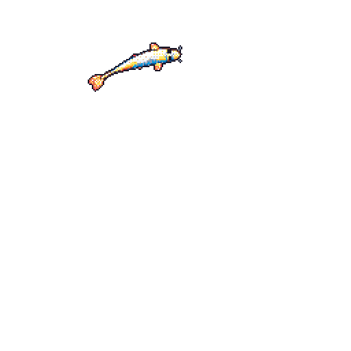

<p align="center">
  
</p>

## 💫 About Me
🔭 I'm currently working on AI development projects, including a semantic search engine for short-form video 🎬<br>
👯 I'm looking to collaborate on open-source AI/ML projects 🤖<br>
🤝 I'm looking for help with getting started in open source contributions and electronics 🔌<br>
🌱 I'm currently learning Data Structures & Algorithms in C++, web development, and the basics of electronics ⚙️<br>
💬 Ask me about Python, AI/Data Science, or how to start your first year in tech 🐍<br>
⚡ Fun fact: I'm a first-year AI & Data Science student who loves building things, from code to circuits! 💡

## 🖥️ Terminal
```bash
ayush@github:~$ whoami
Ayush Adhikari | AI & Data Science student

ayush@github:~$ cat stack.txt
C, C++, Python, JavaScript, HTML, MySQL, NumPy, Arduino

ayush@github:~$ cat now.txt
DSA in C++ | AI dev | web dev | electronics | open source

ayush@github:~$ echo $GOAL
Build AI products that actually ship
```

## 🌐 Socials
[](https://instagram.com/_idk.life.1) [](https://linkedin.com/in/akshitcodes-code) [](mailto:akshitadhikari80@gmail.com)

## 💻 Tech Stack
       

<p align="center">
  
</p>

## 🚀 Projects
| Project | Description | Stack |
|---|---|---|
| Video Semantic Search | Search short-form videos by meaning, not just keywords | Python |
| DSA Practice | Problems and notes while learning | C++ |

## 🏅 Hackathons
- **Smart India Hackathon 2026**: team project on semantic search for Reels and Shorts 🎬

## 📜 Certifications
- ☁️ AWS Certified AI Practitioner (AIF-C01): *in progress*
- 🌐 freeCodeCamp Responsive Web Design: *in progress*

## 🗺️ Learning Roadmap
- [x] Python & SQL basics
- [ ] Data Structures & Algorithms in C++
- [ ] Web development
- [ ] Electronics / Arduino projects
- [ ] First open-source contribution

## 📊 GitHub Stats
<p align="center">
  
  
</p>
<p align="center">
  
</p>
<p align="center">
  
</p>
<p align="center">
  
</p>

## 📈 Activity Graph


## 🐍 Contribution Snake


## 🏆 GitHub Trophies
<p align="center">
  
</p>

## ✍️ Random Dev Quote
<p align="center">
  
</p>

---
<p align="center">
  
</p>


